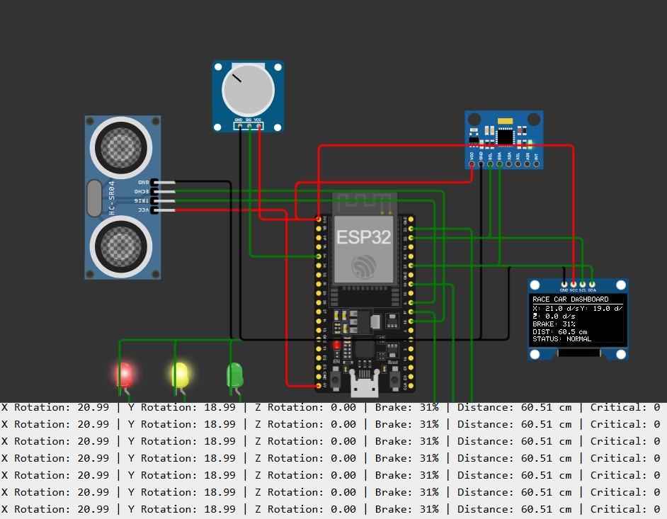

# 🏎️ Race Car Collision Warning & 3-Axis Rotation Monitoring System

An ESP32-based embedded systems project that combines **3-axis gyroscope monitoring, ultrasonic collision detection, and real-time dashboard visualization** to simulate a race car safety monitoring system.

The system uses an MPU6050 to monitor rotational movement across three axes, an HC-SR04 ultrasonic sensor to detect nearby obstacles, and an OLED display to provide real-time vehicle monitoring information.

---

## 📌 Project Overview

The project is designed to simulate a basic race car monitoring and collision warning system using an ESP32 microcontroller.

It integrates three major functionalities:

1. **3-Axis Rotation Monitoring:** Monitors rotational velocity along the X, Y, and Z axes using the MPU6050 gyroscope.
2. **Collision Warning System:** Detects nearby obstacles using an HC-SR04 ultrasonic sensor and activates an emergency LED warning.
3. **Digital Dashboard:** Displays rotational readings, simulated brake pressure, and obstacle distance on an OLED display.

The ESP32 acts as the central processing unit, collecting sensor data, processing inputs, and controlling the visual warning system.

## 🎯 Project Objectives

- Implement a 3-axis rotational monitoring system.
- Interface multiple sensors with an ESP32.
- Develop a distance-based collision warning mechanism.
- Implement threshold-based LED indicators.
- Display real-time sensor readings using an OLED dashboard.
- Understand I2C communication, GPIO interfacing, and embedded C++ programming.

## 🛠️ Hardware Components

| Component | Quantity | Purpose |
|---|---:|---|
| ESP32 Development Board (38-pin) | 1 | Main controller |
| MPU6050 (GY-521) | 1 | 3-axis accelerometer and gyroscope |
| HC-SR04 Ultrasonic Sensor | 1 | Obstacle detection |
| 0.96-inch OLED Display (SSD1306) | 1 | Real-time dashboard |
| Red LED | 1 | X-axis rotation indicator |
| Yellow LED | 1 | Y-axis rotation indicator |
| Green LED | 1 | Z-axis rotation indicator |
| 220Ω Resistors | 3 | LED current limiting |
| 1kΩ Resistor | 1 | Echo voltage divider |
| 2kΩ Resistor | 1 | Echo voltage divider |
| Potentiometer | 1 | Simulated brake pressure |
| Breadboard | 1 | Circuit assembly |
| Jumper Wires | As required | Connections |

## ⚙️ Software and Technologies

- Arduino IDE
- Embedded C++
- ESP32
- Wokwi Simulator
- I2C Communication
- MPU6050 Sensor Interface
- Ultrasonic Distance Measurement

### Required Arduino Libraries

- Adafruit MPU6050
- Adafruit Unified Sensor
- Adafruit GFX Library
- Adafruit SSD1306

## 🔌 Pin Configuration

| Component | Pin | ESP32 GPIO |
|---|---|---:|
| HC-SR04 | TRIG | GPIO 5 |
| HC-SR04 | ECHO | GPIO 16 |
| MPU6050 | SDA | GPIO 21 |
| MPU6050 | SCL | GPIO 22 |
| OLED Display | SDA | GPIO 21 |
| OLED Display | SCL | GPIO 22 |
| Red LED | Anode | GPIO 23 |
| Yellow LED | Anode | GPIO 19 |
| Green LED | Anode | GPIO 17 |
| Brake Potentiometer | Signal | GPIO 34 |

**Power Connections:**
- ESP32 powered through USB.
- MPU6050 powered through 3.3V.
- OLED powered through 3.3V.
- HC-SR04 powered through 5V.
- All components share a common ground.

**Important:** The HC-SR04 Echo pin outputs 5V logic. A voltage divider must be used before connecting it to the ESP32's 3.3V GPIO.

## 🧠 Working Principle

### 1. 3-Axis Rotation Monitoring

The MPU6050 gyroscope measures angular velocity along three axes.

The readings are converted from radians per second into degrees per second (°/s).

Each axis is assigned an individual LED:

| Axis | LED | GPIO |
|---|---|---:|
| X-axis | Red | 23 |
| Y-axis | Yellow | 19 |
| Z-axis | Green | 17 |

The system uses two rotational thresholds:

- **5°/s to 45°/s:** The corresponding LED glows continuously.
- **Above 45°/s:** All three LEDs blink simultaneously as a critical warning.

Both positive and negative rotational values are considered.

### 2. Collision Warning System

The HC-SR04 measures the distance between the vehicle and an obstacle using ultrasonic sound waves.

Distance is calculated using:

Distance = (Echo Time × Speed of Sound) / 2

The system uses a predefined collision threshold of 15 cm.

- Distance greater than 15 cm: Normal operation.
- Distance at or below 15 cm: All three LEDs blink simultaneously.

Collision warnings override normal rotational LED indications.

### 3. OLED Digital Dashboard

An SSD1306 OLED display provides real-time monitoring information.

The dashboard displays:

- X-axis rotational velocity (°/s).
- Y-axis rotational velocity (°/s).
- Z-axis rotational velocity (°/s).
- Brake pressure (percentage).
- Distance from nearby obstacles (cm).
- Overall system warning status.

The brake pressure is currently simulated using a potentiometer, with its analog reading mapped to a percentage.

## 🚨 LED Warning Logic

| Condition | Red | Yellow | Green |
|---|---|---|---|
| No significant rotation | OFF | OFF | OFF |
| X rotation (5–45°/s) | ON | OFF | OFF |
| Y rotation (5–45°/s) | OFF | ON | OFF |
| Z rotation (5–45°/s) | OFF | OFF | ON |
| Multiple axes (5–45°/s) | ON | ON | ON |
| Any axis above 45°/s | BLINK | BLINK | BLINK |
| Obstacle within 15 cm | BLINK | BLINK | BLINK |

## 🖥️ Simulation

The project can be simulated using Wokwi.

The MPU6050 simulation allows independent manipulation of:
- X-axis rotation.
- Y-axis rotation.
- Z-axis rotation.
- Accelerometer readings.

The gyroscope rotation controls are used for the LED warning logic.

The HC-SR04 and potentiometer can be adjusted to test collision detection and brake pressure visualization.

## 📂 Project Structure

```text
Race-Car-Monitoring-System/
│
├── README.md
│
├── src/
│   └── race_car_monitor.ino
│
├── diagrams/
│   └── circuit_diagram.png
│
└── simulation/
    └── wokwi_project_link.txt
```

*The folder structure above is a suggested GitHub organization.*

## 🚀 Future Enhancements

- Integration of an actual brake pressure sensor.
- Advanced sensor fusion for more accurate vehicle orientation estimation.
- Wireless telemetry using ESP32 Wi-Fi.
- Graphical dashboard for live monitoring on a computer.
- Data logging for vehicle movement analysis.
- Integration with CAN bus for automotive applications.
- Improved collision warning using multiple ultrasonic sensors.

## 📚 Applications

- Automotive embedded systems.
- Race car monitoring and safety systems.
- Vehicle orientation monitoring.
- Collision warning prototypes.
- IoT-based automotive instrumentation.
- Embedded systems education and experimentation.

## 👨‍💻 Project Information

**Project Category:** Embedded Systems / Automotive Electronics

**Microcontroller:** ESP32 (38-pin Development Board)

**Programming Language:** C++ (Arduino Framework)

**Simulation Platform:** Wokwi

**Primary Sensors:** MPU6050 and HC-SR04

**Display:** SSD1306 OLED

---

*Developed as an embedded systems project exploring automotive safety monitoring, sensor integration, and real-time data visualization.*


## 📸 Project Demonstration

### Circuit Diagram


### Wokwi Simulation

